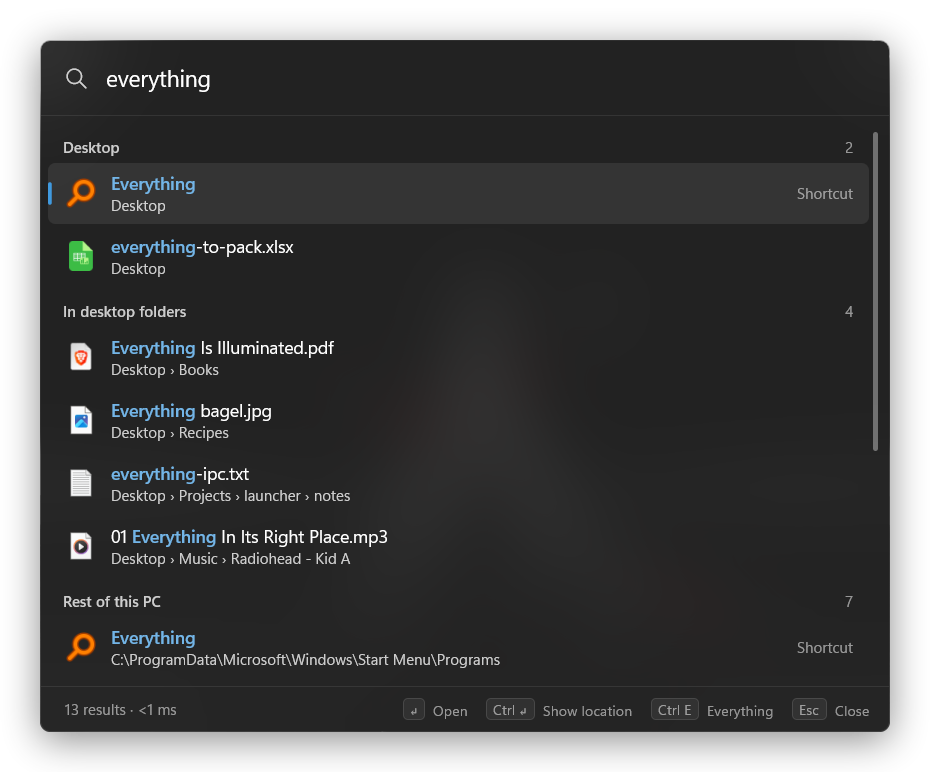
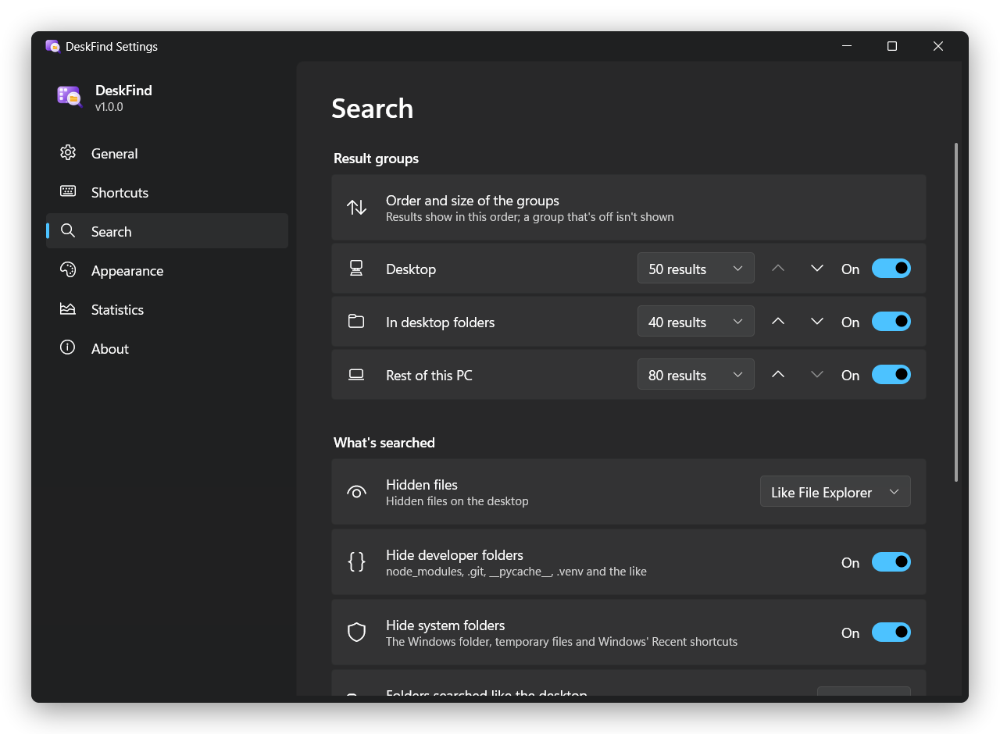

<p align="center">
  
</p>

<h1 align="center">DeskFind</h1>

<p align="center">
  <b>Ctrl+F for your Windows desktop.</b><br>
  Press Ctrl+F on the desktop and type: the desktop answers first, then the folders on it, then the rest of your PC.
</p>

<p align="center">
  <a href="https://github.com/Bilalatss/DeskFind/releases/latest"></a>
  
  
  <a href="LICENSE"></a>
</p>

<p align="center">
  
</p>

<p align="center"><a href="README.tr.md">Türkçe</a></p>

---

Windows has no quick way to search just the desktop. Start search looks through the whole PC and mixes in apps and
web results, and Explorer's search needs a window first and takes its time.

DeskFind puts a search box on the desktop's own Ctrl+F, and only there: in every other window, Ctrl+F still belongs
to the app you're in. If you'd rather have it everywhere, or on other keys, that's one setting away.

## Features

- **Desktop first.** Results come in three groups: *Desktop*, *In desktop folders* and *Rest of this PC*.
- **Instant.** The desktop and its folders answer from memory in 1–3 ms per keystroke. The rest of the PC comes from [Everything](https://www.voidtools.com) in about 40–60 ms.
- **Finds the icon.** Ctrl+Enter selects the file's icon on the desktop itself, or opens its folder in Explorer when it lives elsewhere.
- **Learns.** What you open often moves up, and the empty box lists what you opened recently.
- **Skips the noise.** `node_modules`, `.git`, `__pycache__` and similar folders never show up. Neither do the Windows folder, temp files and Windows' *Recent* shortcuts. Build output, app data and logs come after your own files.
- **Yours to set up.** A settings window in the style of Windows 11 Settings covers the shortcuts, the result groups, which folders count, the look and more. Every change applies at once.
- **Tiny.** A 460 KB exe with no runtime to install. It uses under 1 MB of memory while it waits in the tray.
- **Looks native.** Acrylic, Mica, rounded corners, light and dark mode and your accent color, like Windows itself.
- **Accessible.** Narrator and other screen readers can read and use the search box, the results and every setting, and
  Windows' contrast themes are followed.
- **English and Turkish.** It follows the Windows display language unless you pick one.
- **Private.** No network access, no telemetry.

## Install

You need Windows 11. To search beyond the desktop you also need [Everything](https://www.voidtools.com/downloads/) (free),
which the script offers to install. Paste this into PowerShell:

```powershell
irm https://raw.githubusercontent.com/Bilalatss/DeskFind/main/install.ps1 | iex
```

The [script](install.ps1):

- downloads `DeskFind.exe` (the Arm64 build on Windows on Arm) from the latest release and checks its SHA-256 against the release;
- offers to install Everything with winget if it is missing;
- copies it to `%LOCALAPPDATA%\Programs\DeskFind`;
- adds it to the Start menu and to *Settings › Apps*;
- starts it.

From then on DeskFind starts with Windows; you can turn that off in the tray menu. The script needs no admin rights
(installing Everything asks for them once). Run the same line again to update.

<details>
<summary>Why a command and not a setup.exe or .msi?</summary>

DeskFind isn't code-signed yet. An unsigned `.exe` or `.msi` downloaded in a browser usually gets a SmartScreen
warning; a file downloaded by PowerShell doesn't. The script is short, so read it before you run it.
</details>

<details>
<summary>Install by hand</summary>

Download `DeskFind.exe` from [Releases](https://github.com/Bilalatss/DeskFind/releases/latest), open PowerShell in that
folder and run `.\DeskFind.exe --install`. Windows may warn you first because the file came from a browser.

You can also run the exe from any folder without installing it. In that case it doesn't show up in the Start menu or
in *Settings › Apps*, but it still turns on starting with Windows from that folder.
</details>

**Uninstall:** use *Settings › Apps › DeskFind › Uninstall*, or run:

```powershell
& "$env:LOCALAPPDATA\Programs\DeskFind\DeskFind.exe" --uninstall
```

This removes the exe, its Start menu entry, its settings, its history and the autostart entry.

## Use

Click an empty spot on the desktop (or press <kbd>Win</kbd>+<kbd>D</kbd>), press <kbd>Ctrl</kbd>+<kbd>F</kbd> and type.

| Key | Action |
| --- | --- |
| <kbd>↑</kbd> <kbd>↓</kbd> · <kbd>PgUp</kbd> <kbd>PgDn</kbd> | Move through the results |
| <kbd>Enter</kbd> or click | Open |
| <kbd>Ctrl</kbd>+<kbd>Enter</kbd> or <kbd>Ctrl</kbd>+click | Show it: select its icon on the desktop, or open its folder |
| <kbd>Ctrl</kbd>+<kbd>Shift</kbd>+<kbd>C</kbd> | Copy the full path |
| <kbd>Ctrl</kbd>+<kbd>E</kbd> | Continue the search in Everything |
| <kbd>F5</kbd> | Search again |
| <kbd>Ctrl</kbd>+<kbd>,</kbd> or the ⚙ button | Open the settings |
| <kbd>Esc</kbd> | Close and go back to the desktop |

**Search tips**

- Words match in any order, and case and accents don't matter: `cafe` finds *Café* and `i` finds *ı*.
- Everything's syntax works as well: `ext:pdf`, `*.psd`, `dm:today`, `!draft`, `invoice | receipt`.
- Clicking the tray icon (often hidden under <kbd>^</kbd>) or *DeskFind* in the Start menu also opens the box.
- Right-click the tray icon for *Settings*, *Start with Windows*, *About DeskFind* and *Exit*.

## Settings

Open them from the tray menu, the ⚙ button in the search box, <kbd>Ctrl</kbd>+<kbd>,</kbd> or `DeskFind.exe --settings`.

<p align="center">
  
</p>

| Page | What you can change |
| --- | --- |
| **General** | Start with Windows, the tray icon, the language, back to the defaults |
| **Shortcuts** | The desktop shortcut, and a second one that opens DeskFind over any window (off at first, <kbd>Win</kbd>+<kbd>Shift</kbd>+<kbd>F</kbd>). Click a shortcut and press new keys; DeskFind tells you when another app already has them. |
| **Search** | The order of the three groups, how many results each shows, and which are on. Hidden files, developer and system folders, extra folders searched like the desktop (Downloads, say), excluded folders, and ranking. Everything's status, with a button that installs or starts it. |
| **Appearance** | Theme, width of the search box, which screen it opens on, transparency, animations, key hints |
| **Statistics** | Searches, opened items, average answer time, what you open most, the size of the folder index. Clear the history or reset the counts. |
| **About** | Version, links and license |

## How it works

| Group | Source |
| --- | --- |
| **Desktop** | Listed straight from disk each time the box opens, so it's always current. It follows Explorer's hidden-file settings and includes the Public desktop. |
| **In desktop folders** | When the box opens, one Everything query loads every file and folder under the desktop into a compact in-memory index (26,000 entries take 1.4 MB). Without Everything, the same tree is read from disk on a background thread (about 0.3 s for 26,000 entries). Each keystroke filters it locally. The index is dropped a few seconds after the box closes. |
| **Rest of this PC** | Everything's IPC, with no SDK DLL. Everything sends the 1,000 most recently changed matches and DeskFind ranks them. Answers are cached, and a longer query is filtered locally when a shorter one already returned every match. |

- **Ranking:** the best name match comes first: the exact name, then the start of the name, the start of a word, and anywhere in the name. Among equal matches, what you open often and recently goes up, and build output, caches and app data go down.
- **Drawing:** DeskFind draws its own windows, the settings included. DirectWrite glyphs are rasterized on the CPU into a bitmap shown in a DWM acrylic window. There is no UI framework and no GPU context, so there is very little to keep in memory while it's hidden.
- **Accessibility:** since nothing on screen is a standard control, both windows describe themselves to screen readers through UI Automation. In a contrast theme they drop the transparency and draw with the theme's own colors.
- **Idle:** a few seconds after the box closes, DeskFind frees its caches, trims its memory and asks Windows to run it in efficiency mode.
- **Speed:** while the box is open, DeskFind lets Everything out of Windows 11's efficiency mode. Its queries got about 30% faster in testing.

## Performance

Measured on the author's PC (Windows 11 24H2, about 2.6 million files indexed by Everything):

| | |
| --- | --- |
| Ctrl+F to window on screen | 10–33 ms |
| Desktop and desktop folders, per keystroke | 1–3 ms |
| Rest of the PC, through Everything | 40–60 ms |
| Typing on (filtered from the cache) | ~1 ms |
| Memory while waiting in the tray | 0.3–0.7 MB |
| Memory with the box open | ~5 MB |
| Download | 460 KB |

## Requirements

- **Windows 11**, x64 or Arm64. It is built and tested on 24H2 (x64); the Arm64 build is made by the same CI but untested on an Arm PC. Windows 10 is untested; the window relies on Windows 11's acrylic and rounded corners.
- **[Everything](https://www.voidtools.com/downloads/) 1.4** by voidtools, the regular version, for the rest of the PC.
  - *Everything Lite* has no IPC, so it won't work.
  - If Everything is installed but not running, DeskFind starts it.
  - Tested with 1.4.1. The 1.5 alpha should work but is untested.
  - Without Everything, the desktop and its folders are still searched. The *Rest of this PC* group then shows a row
    that installs Everything with winget (one UAC prompt) or opens its download page.

## Build from source

You need Visual Studio 2022 or later (or its Build Tools) with *Desktop development with C++*.

```bat
build.cmd            :: bin\DeskFind.exe
build.cmd install    :: build, then install it for this user
build.cmd test       :: build, then run the tests (bin\DeskFindTests.exe)
build.cmd arm64      :: bin\DeskFind-arm64.exe for Windows on Arm (needs the MSVC ARM64 build tools)
build.cmd analyze    :: MSVC code analysis of every source file; any warning fails it
build.cmd trace      :: bin\DeskFindTrace.exe, logging timings to %LOCALAPPDATA%\DeskFind\trace.log
```

The tests (`tests/tests.cpp`) check the name matching, the Everything reply parser against malformed replies, and the
whole search pipeline over a folder tree they make, read from disk so that Everything isn't needed. GitHub Actions runs
the code analysis and the tests on every push and pull request.

There is also a headless test of the search pipeline. DeskFind is a windowed program, so wait for it with `start /wait`:

```bat
start /wait bin\DeskFind.exe --selftest out.txt @index "d>de>des" report
```

In this command:

- `>` types one prefix at a time;
- `+` types them in a burst;
- `@index` builds the desktop-folder index first;
- `@settings` searches the way the saved settings say.

| File | What it does |
| --- | --- |
| `src/app.cpp` | The search window's life, the tray, the desktop-only hotkey and setting Everything up |
| `src/appview.cpp`, `src/appinput.cpp` | What the search window shows and paints; its text box, list, keyboard and mouse |
| `src/access.cpp`, `src/appaccess.cpp`, `src/settingsaccess.cpp` | UI Automation, for screen readers |
| `src/search.cpp` | The three groups, ranking, caching and the desktop-folder index |
| `src/everything.cpp` | Everything IPC on its own thread |
| `src/canvas.cpp`, `src/text.cpp` | The software renderer and DirectWrite text |
| `src/icons.cpp` | File icons, loaded on a background thread |
| `src/history.cpp` | What you opened, for ranking and *Recently opened* |
| `src/tray.cpp`, `src/shell.cpp` | The tray icon and menu; opening, revealing and autostart |
| `src/settings.cpp`, `src/settingsui.cpp` | The settings, and the window to change them |
| `src/setup.cpp` | `--install` and `--uninstall` |
| `src/lang.cpp` | English and Turkish text |
| `tests/tests.cpp` | The tests |

Releases are built by [GitHub Actions](.github/workflows/build.yml) from a `v*` tag, which must match `src/version.h`
(and the version in `res/app.manifest`).

## Privacy

DeskFind makes no network connections. *About DeskFind* in the tray menu opens this page in your browser.

On disk it keeps:

- a list of what you opened from it (`history.txt`, up to 300 entries), used for ranking and *Recently opened*;
- an `error.log`, only if something fails.

Both are in `%LOCALAPPDATA%\DeskFind`. In the registry, under `HKCU\Software\DeskFind`, it keeps its settings and
usage counts (numbers only, never names or searches). It also keeps its autostart entry and its *Settings › Apps*
entry. Uninstalling removes all of them.

## FAQ

**Ctrl+F doesn't open it.** The desktop has to be the active window, so click an empty spot on it first. In any other window, Ctrl+F belongs to that window.

**How do I start it again after *Exit*?** Open *DeskFind* from the Start menu.

**Can I use English on a Turkish Windows, or the other way round?** Yes: *Settings › General › Language*.

**I turned the tray icon off. How do I get to the settings?** Open the search box and click ⚙ (or press <kbd>Ctrl</kbd>+<kbd>,</kbd>), or start *DeskFind* from the Start menu and do the same.

**Smart App Control blocks it.** Smart App Control blocks unsigned apps and has no exceptions, and DeskFind isn't signed yet.

**Which monitor does it open on?** The one your mouse pointer is on.

**Do I have to install Everything?** No. The desktop and its folders are searched without it; only the *Rest of this PC*
group needs it. Click the row that group shows to install Everything, or turn the group off in *Settings › Search*
and the row goes away.

## License

[MIT](LICENSE). DeskFind uses [Everything](https://www.voidtools.com) by voidtools through its public IPC interface and isn't affiliated with voidtools.
